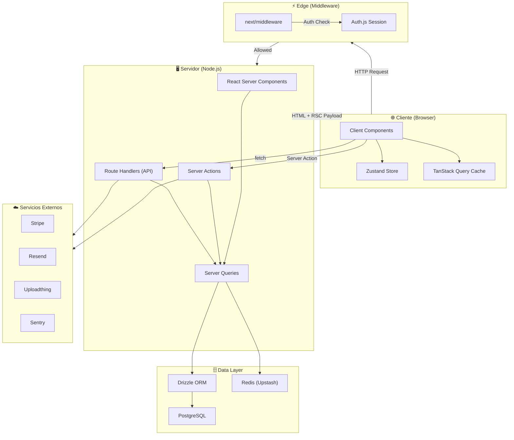

# 🏗️ Arquitectura & Stack Tecnológico — React + TypeScript + Next.js

> Documento de referencia para agentes y desarrolladores. Define la estructura de carpetas, tecnologías, convenciones y mejores prácticas para construir una aplicación web moderna con **React**, **TypeScript** y **Next.js (App Router)**.

---

## 1. Stack Principal

| Capa | Tecnología | Versión mínima | Propósito |
|---|---|---|---|
| **Framework** | Next.js (App Router) | 15.x | SSR, SSG, ISR, API Routes, Middleware |
| **UI Library** | React | 19.x | Componentes, Server Components, Suspense |
| **Lenguaje** | TypeScript | 5.x | Tipado estático, seguridad en tiempo de compilación |
| **Runtime** | Node.js | 22 LTS | Entorno de ejecución del servidor |
| **Package Manager** | pnpm | 9.x | Gestión de dependencias (rápido, eficiente en disco) |

---

## 2. Estructura de Carpetas

```
project-root/
├── .github/                    # CI/CD workflows (GitHub Actions)
│   └── workflows/
│       ├── ci.yml
│       └── deploy.yml
├── public/                     # Archivos estáticos (favicon, og-image, robots.txt)
├── src/
│   ├── app/                    # 📂 App Router (Next.js)
│   │   ├── (marketing)/        #   Route Group — páginas públicas
│   │   │   ├── page.tsx        #     Landing / Home
│   │   │   ├── about/
│   │   │   └── pricing/
│   │   ├── (dashboard)/        #   Route Group — zona autenticada
│   │   │   ├── layout.tsx
│   │   │   ├── dashboard/
│   │   │   └── settings/
│   │   ├── api/                #   Route Handlers (REST / webhooks)
│   │   │   └── [...route]/
│   │   ├── layout.tsx          #   Root layout
│   │   ├── not-found.tsx       #   404 personalizado
│   │   ├── error.tsx           #   Error boundary global
│   │   ├── loading.tsx         #   Skeleton / loading global
│   │   └── globals.css         #   Estilos globales (Tailwind base)
│   │
│   ├── components/             # 📂 Componentes reutilizables
│   │   ├── ui/                 #   Primitivos (Button, Input, Dialog…)
│   │   ├── layout/             #   Header, Footer, Sidebar, Nav
│   │   ├── forms/              #   Formularios compuestos
│   │   └── shared/             #   Componentes compartidos entre features
│   │
│   ├── features/               # 📂 Módulos por dominio / feature
│   │   ├── auth/
│   │   │   ├── components/
│   │   │   ├── hooks/
│   │   │   ├── actions/        #   Server Actions
│   │   │   ├── schemas/        #   Zod schemas
│   │   │   └── types.ts
│   │   ├── billing/
│   │   └── projects/
│   │
│   ├── hooks/                  # 📂 Custom hooks globales
│   │   ├── use-debounce.ts
│   │   ├── use-media-query.ts
│   │   └── use-local-storage.ts
│   │
│   ├── lib/                    # 📂 Utilidades y configuraciones
│   │   ├── db.ts               #   Cliente de base de datos (Drizzle/Prisma)
│   │   ├── auth.ts             #   Configuración de autenticación
│   │   ├── api-client.ts       #   Fetch wrapper tipado
│   │   ├── constants.ts        #   Constantes globales
│   │   ├── utils.ts            #   Helpers puros (cn, formatDate…)
│   │   └── validations.ts      #   Schemas de validación compartidos
│   │
│   ├── server/                 # 📂 Lógica exclusiva del servidor
│   │   ├── actions/            #   Server Actions globales
│   │   ├── queries/            #   Data fetching (cached)
│   │   └── services/           #   Lógica de negocio del servidor
│   │
│   ├── stores/                 # 📂 Estado global del cliente
│   │   └── use-app-store.ts    #   Zustand store
│   │
│   ├── styles/                 # 📂 Estilos adicionales
│   │   └── themes/
│   │
│   ├── types/                  # 📂 Tipos TypeScript globales
│   │   ├── index.d.ts
│   │   └── api.ts
│   │
│   └── config/                 # 📂 Configuración de la app
│       ├── site.ts             #   Metadata, nav links, etc.
│       └── env.ts              #   Validación de env vars (t3-env)
│
├── prisma/                     # Schema y migraciones (si se usa Prisma)
│   └── schema.prisma
├── drizzle/                    # Schema y migraciones (si se usa Drizzle)
│
├── tests/                      # 📂 Tests
│   ├── e2e/                    #   Playwright E2E
│   ├── integration/            #   Tests de integración
│   └── unit/                   #   Tests unitarios (Vitest)
│
├── .env.local                  # Variables de entorno locales (git-ignored)
├── .env.example                # Plantilla de variables de entorno
├── .eslintrc.cjs               # ESLint config
├── .prettierrc                 # Prettier config
├── tailwind.config.ts          # Tailwind config
├── tsconfig.json               # TypeScript config
├── next.config.ts              # Next.js config
├── vitest.config.ts            # Vitest config
├── playwright.config.ts        # Playwright config
├── components.json             # shadcn/ui config
└── package.json
```

---

## 3. Tecnologías Complementarias

### 🎨 Estilos & UI

| Tecnología | Propósito |
|---|---|
| **Tailwind CSS v4** | Utility-first CSS, diseño rápido y consistente |
| **shadcn/ui** | Componentes accesibles y personalizables (Radix + Tailwind) |
| **Radix UI** | Primitivos headless accesibles (base de shadcn/ui) |
| **Lucide React** | Iconos SVG consistentes y tree-shakeable |
| **Framer Motion** | Animaciones declarativas y gestos |
| **next/font** | Carga optimizada de tipografías (self-hosted) |
| **clsx + tailwind-merge** | Composición condicional de clases CSS (`cn()`) |

### 📊 Estado & Data Fetching

| Tecnología | Propósito |
|---|---|
| **React Server Components** | Fetching en servidor, zero JS al cliente |
| **Server Actions** | Mutaciones tipo RPC sin API routes |
| **TanStack Query (React Query) v5** | Cache, revalidación y sync del estado del servidor en el cliente |
| **Zustand** | Estado global ligero del cliente (UI, modales, preferencias) |
| **nuqs** | Estado sincronizado con query params de la URL |

### 🗄️ Base de Datos & ORM

| Tecnología | Propósito |
|---|---|
| **PostgreSQL** | Base de datos relacional principal |
| **Drizzle ORM** | ORM type-safe, ligero, SQL-like (alternativa moderna a Prisma) |
| **Drizzle Kit** | Migraciones y gestión del schema |
| **Redis (Upstash)** | Cache, rate limiting, sesiones, colas |

> [!TIP]
> **Drizzle vs Prisma**: Drizzle genera queries más eficientes, tiene menor overhead en runtime y ofrece una API más cercana a SQL. Prisma sigue siendo válido para prototipado rápido con su API intuitiva. Elige Drizzle para producción, Prisma para MVPs.

### 🔐 Autenticación & Autorización

| Tecnología | Propósito |
|---|---|
| **NextAuth.js v5 (Auth.js)** | Autenticación con providers OAuth, credentials, magic links |
| **Middleware de Next.js** | Protección de rutas a nivel edge |
| **Zod** | Validación de inputs (forms, API, server actions) |

### 📧 Servicios Externos

| Tecnología | Propósito |
|---|---|
| **Resend** | Envío de emails transaccionales |
| **React Email** | Plantillas de email con componentes React |
| **Stripe** | Pagos, suscripciones, billing |
| **Uploadthing** | Upload de archivos (S3 simplificado) |
| **Sentry** | Monitorización de errores (client + server) |
| **PostHog / Vercel Analytics** | Analytics y feature flags |

### 🧪 Testing

| Tecnología | Propósito |
|---|---|
| **Vitest** | Tests unitarios y de integración (compatible con Jest, más rápido) |
| **React Testing Library** | Tests de componentes centrados en el usuario |
| **Playwright** | Tests E2E cross-browser |
| **MSW (Mock Service Worker)** | Mocking de APIs en tests y desarrollo |

### 🔧 Herramientas de Desarrollo

| Tecnología | Propósito |
|---|---|
| **ESLint** | Linting con reglas de Next.js + TypeScript |
| **Prettier** | Formateo consistente de código |
| **Husky + lint-staged** | Pre-commit hooks (lint + format) |
| **commitlint** | Convención de commits (Conventional Commits) |
| **T3 Env** | Validación tipada de variables de entorno |
| **Bundle Analyzer** | Análisis del tamaño del bundle |

### ☁️ Infraestructura & Deploy

| Tecnología | Propósito |
|---|---|
| **Vercel** | Deploy optimizado para Next.js (edge, serverless) |
| **GitHub Actions** | CI/CD (lint, test, build, deploy) |
| **Docker** | Contenedorización para self-hosting |
| **Turborepo** | Monorepo (si el proyecto escala a múltiples packages) |

---

## 4. Convenciones de Código

### Nomenclatura

```
Archivos de componente  → PascalCase.tsx      (Button.tsx, UserCard.tsx)
Archivos de hook        → use-kebab-case.ts   (use-debounce.ts)
Archivos de utilidad    → kebab-case.ts       (api-client.ts)
Archivos de tipo        → kebab-case.ts       (api.ts) o PascalCase.ts
Carpetas                → kebab-case           (user-profile/)
Route segments          → kebab-case           (/dashboard/user-settings)
Constantes              → SCREAMING_SNAKE_CASE (MAX_RETRIES)
Tipos/Interfaces        → PascalCase           (UserProfile, ApiResponse<T>)
Funciones               → camelCase            (getUserById, formatCurrency)
```

### Patrones Clave

```typescript
// ✅ Server Component por defecto (sin "use client")
// src/app/(dashboard)/dashboard/page.tsx
import { getProjects } from "@/server/queries/projects";

export default async function DashboardPage() {
  const projects = await getProjects();
  return <ProjectList projects={projects} />;
}

// ✅ Client Component solo cuando es necesario
// src/components/ui/counter.tsx
"use client";

import { useState } from "react";

export function Counter() {
  const [count, setCount] = useState(0);
  return <button onClick={() => setCount(c => c + 1)}>{count}</button>;
}

// ✅ Server Action para mutaciones
// src/features/projects/actions/create-project.ts
"use server";

import { z } from "zod";
import { revalidatePath } from "next/cache";
import { db } from "@/lib/db";

const schema = z.object({
  name: z.string().min(1).max(100),
  description: z.string().optional(),
});

export async function createProject(formData: FormData) {
  const parsed = schema.safeParse(Object.fromEntries(formData));
  if (!parsed.success) return { error: parsed.error.flatten() };

  await db.insert(projects).values(parsed.data);
  revalidatePath("/dashboard");
}

// ✅ Alias de imports con @/
// tsconfig.json → paths: { "@/*": ["./src/*"] }
import { Button } from "@/components/ui/button";
import { cn } from "@/lib/utils";
```

### Reglas para Agentes

> [!IMPORTANT]
> 1. **Server Components por defecto** — Solo usa `"use client"` cuando necesites hooks de React (useState, useEffect) o event handlers del navegador.
> 2. **Coloca lógica en `features/`** — Cada dominio agrupa sus componentes, hooks, actions y tipos. Evita archivos sueltos.
> 3. **Valida siempre con Zod** — Formularios, server actions, API routes y variables de entorno.
> 4. **No uses `any`** — Tipado estricto. Usa `unknown` + type guards si es necesario.
> 5. **Imports con alias `@/`** — Nunca imports relativos que suban más de un nivel (`../../`).
> 6. **CSS con Tailwind** — No uses CSS modules ni styled-components. Usa `cn()` para clases condicionales.
> 7. **Componentes pequeños** — Si un componente supera ~150 líneas, divídelo.
> 8. **Archivos de barrel (`index.ts`) opcionales** — Úsalos solo en `components/ui/` para re-exports limpios.
> 9. **Error boundaries** — Cada route group debe tener su `error.tsx` y `loading.tsx`.
> 10. **Env vars tipadas** — Usa `@t3-oss/env-nextjs` para validar y tipar todas las variables de entorno.

---

## 5. Configuración Base

### `tsconfig.json`

```jsonc
{
  "compilerOptions": {
    "target": "ES2022",
    "lib": ["dom", "dom.iterable", "esnext"],
    "allowJs": true,
    "skipLibCheck": true,
    "strict": true,
    "noEmit": true,
    "esModuleInterop": true,
    "module": "esnext",
    "moduleResolution": "bundler",
    "resolveJsonModule": true,
    "isolatedModules": true,
    "jsx": "preserve",
    "incremental": true,
    "plugins": [{ "name": "next" }],
    "paths": {
      "@/*": ["./src/*"]
    }
  },
  "include": ["next-env.d.ts", "**/*.ts", "**/*.tsx", ".next/types/**/*.ts"],
  "exclude": ["node_modules"]
}
```

### `next.config.ts`

```typescript
import type { NextConfig } from "next";

const nextConfig: NextConfig = {
  experimental: {
    typedRoutes: true,       // Rutas tipadas
    serverActions: {
      bodySizeLimit: "2mb",
    },
  },
  images: {
    remotePatterns: [
      // Añadir dominios de imágenes remotas aquí
    ],
  },
  // Headers de seguridad
  async headers() {
    return [
      {
        source: "/(.*)",
        headers: [
          { key: "X-Frame-Options", value: "DENY" },
          { key: "X-Content-Type-Options", value: "nosniff" },
          { key: "Referrer-Policy", value: "strict-origin-when-cross-origin" },
        ],
      },
    ];
  },
};

export default nextConfig;
```

### Helper `cn()` — `src/lib/utils.ts`

```typescript
import { type ClassValue, clsx } from "clsx";
import { twMerge } from "tailwind-merge";

export function cn(...inputs: ClassValue[]) {
  return twMerge(clsx(inputs));
}
```

---

## 6. Scripts de `package.json`

```json
{
  "scripts": {
    "dev": "next dev --turbopack",
    "build": "next build",
    "start": "next start",
    "lint": "next lint",
    "lint:fix": "next lint --fix",
    "format": "prettier --write .",
    "format:check": "prettier --check .",
    "typecheck": "tsc --noEmit",
    "test": "vitest",
    "test:ui": "vitest --ui",
    "test:e2e": "playwright test",
    "db:generate": "drizzle-kit generate",
    "db:migrate": "drizzle-kit migrate",
    "db:studio": "drizzle-kit studio",
    "postinstall": "npx auth secret"
  }
}
```

---

## 7. Diagrama de Arquitectura



---

## 8. Dependencias Principales

```bash
# Core
pnpm add next@latest react@latest react-dom@latest

# TypeScript
pnpm add -D typescript @types/react @types/react-dom @types/node

# Estilos & UI
pnpm add tailwindcss @tailwindcss/postcss postcss
pnpm add class-variance-authority clsx tailwind-merge
pnpm add lucide-react
pnpm add framer-motion
pnpm dlx shadcn@latest init

# Data Fetching & Estado
pnpm add @tanstack/react-query
pnpm add zustand
pnpm add nuqs

# Base de Datos
pnpm add drizzle-orm postgres
pnpm add -D drizzle-kit

# Auth
pnpm add next-auth@beta

# Validación
pnpm add zod
pnpm add @t3-oss/env-nextjs

# Email
pnpm add resend @react-email/components

# Testing
pnpm add -D vitest @vitejs/plugin-react @testing-library/react @testing-library/jest-dom
pnpm add -D playwright @playwright/test
pnpm add -D msw

# DX
pnpm add -D eslint eslint-config-next prettier
pnpm add -D husky lint-staged @commitlint/cli @commitlint/config-conventional
```

---

> [!NOTE]
> Este documento es una **guía viva**. Actualízalo cuando se añadan nuevas tecnologías, patrones o convenciones al proyecto. Última actualización: **Noviembre 2026**.


<!-- BEGIN:nextjs-agent-rules -->

## This is NOT the Next.js you know

This version has breaking changes — APIs, conventions, and file structure may all differ from your training data. Read the relevant guide in `node_modules/next/dist/docs/` (resolved from this file's directory; in monorepos the `next` package may not be visible from the repo root) before writing any code. Heed deprecation notices.

This block is written and re-added by `next dev` — verify at `node_modules/next/dist/server/lib/generate-agent-files.js`. Removing it from a diff only re-creates the uncommitted change; committing it with your work keeps the tree clean.

<!-- END:nextjs-agent-rules -->
